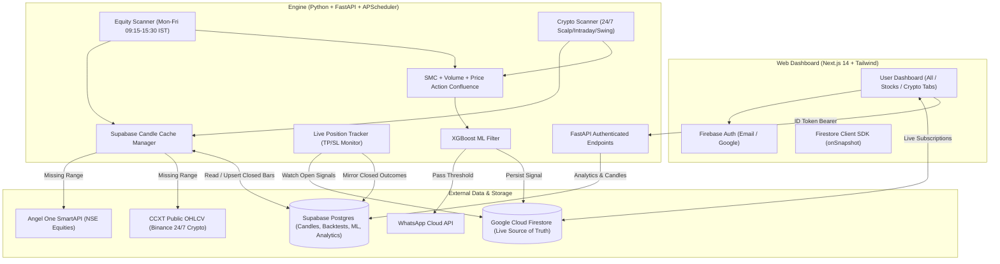

# SignalDesk &mdash; Multi-Asset Quantitative Trading Signal Platform (NSE Equities & 24/7 Crypto)

**SignalDesk** is an institutional-grade algorithmic trading signal engine and web platform supporting **Indian Equities (NSE)** and **24/7 Cryptocurrencies (USDT pairs)**. It scans user-selected watchlists using **Smart Money Concepts (SMC)**, **Volume Profile**, and **Price Action** confluences, filters setups through a walk-forward **XGBoost ML classifier**, persists real-time alerts to **Google Cloud Firestore**, caches historical candles and analytics in **Supabase (PostgreSQL)**, and dispatches instant alerts via the **Meta WhatsApp Cloud API**.

> [!IMPORTANT]
> **Signal Tool Only:** SignalDesk is strictly an educational signal generator and quantitative research tool. It **never** places automated trades or holds exchange/broker trading keys. Not financial advice. Trading involves risk. Crypto is highly volatile.

---

## 1. System Architecture



---

## 2. Multi-Asset Timeframe Matrix

| Asset Class | Exchange | Schedule | Trade Type | Entry Timeframe | HTF Bias Timeframe |
| :--- | :--- | :--- | :--- | :--- | :--- |
| **Stocks (`equity`)** | `NSE` | Mon–Fri 09:15–15:30 IST | `INTRADAY` | `5m` (`FIVE_MINUTE`) | `1h` / `15m` |
| **Stocks (`equity`)** | `NSE` | Mon–Fri 15:35 IST | `DELIVERY` | `1d` (`ONE_DAY`) | `1w` (`WEEKLY`) |
| **Crypto (`crypto`)** | `BINANCE` | **24/7** (Every 5m) | `SCALP` | `5m` | `1h` |
| **Crypto (`crypto`)** | `BINANCE` | **24/7** (Every 15m) | `INTRADAY` | `15m` | `4h` |
| **Crypto (`crypto`)** | `BINANCE` | **24/7** (Every 4h) | `SWING` | `4h` | `1d` |

---

## 3. Environment Variables Reference

Secrets live **exclusively** in `engine/.env` and `web/.env.local`. Never commit, print, or expose them.
- The Supabase secret key (`SUPABASE_SECRET_KEY`) and `DATABASE_URL` live **only** in `engine/.env`. The browser never talks directly to Supabase.

### Engine Variables (`engine/.env`)

| Variable Name | Purpose |
| :--- | :--- |
| `ANGEL_API_KEY` | Angel One SmartAPI App Key (read-only market data) |
| `ANGEL_CLIENT_ID` | Angel One Client ID |
| `ANGEL_PIN` | Angel One Account PIN |
| `ANGEL_TOTP_SECRET` | Base32 TOTP Seed for automated SmartAPI session login |
| `FIREBASE_SERVICE_ACCOUNT` | Path to Firebase Admin SDK JSON (`serviceAccountKey.json`) |
| `SUPABASE_URL` | Supabase Project URL (`https://<project-ref>.supabase.co`) |
| `SUPABASE_SECRET_KEY` | Supabase Service Role / Secret Key (server-side only) |
| `DATABASE_URL` | PostgreSQL connection string for SQL migrations |
| `CRYPTO_EXCHANGE` | Default public CCXT exchange (`binance`) |
| `WHATSAPP_PHONE_NUMBER_ID` | Meta WhatsApp Cloud API Phone Number ID |
| `WHATSAPP_ACCESS_TOKEN` | Meta System User Access Token |
| `PAPER_MODE` | Paper/signal-only safety flag (`true`) |
| `ML_THRESHOLD` | Minimum XGBoost win probability threshold (`0.60`) |
| `WEB_ORIGIN` | Allowed frontend CORS origin (`http://localhost:3000`) |

### Web Variables (`web/.env.local`)

| Variable Name | Purpose |
| :--- | :--- |
| `NEXT_PUBLIC_FIREBASE_API_KEY` | Firebase Client Web API Key |
| `NEXT_PUBLIC_FIREBASE_AUTH_DOMAIN` | Firebase Auth Domain |
| `NEXT_PUBLIC_FIREBASE_PROJECT_ID` | Firebase Project ID |
| `NEXT_PUBLIC_FIREBASE_APP_ID` | Firebase Web App ID |
| `NEXT_PUBLIC_GOOGLE_CLIENT_ID` | Google OAuth Client ID |
| `NEXT_PUBLIC_ENGINE_URL` | SignalDesk FastAPI Engine URL (`http://localhost:8000`) |

---

## 4. Database Setup & Migrations

### A. Supabase (PostgreSQL) Migrations
Apply the idempotent SQL migrations (`001_initial_schema.sql` and `002_multi_asset_crypto_schema.sql`) which create `candles`, `backtest_runs`, `backtest_trades`, `signal_outcomes`, `ml_models`, and `engine_events` with Row Level Security (RLS) enabled on all tables:

```powershell
engine\venv\Scripts\python -m engine.db.apply_migrations
```

### B. Firestore Security Rules & Composite Index
1. Deploy [`firestore.rules`](../firestore.rules):
   ```powershell
   firebase deploy --only firestore:rules
   ```
2. **Composite Index for Signals (`uid` ASC + `createdAt` DESC):**
   Create in Firebase Console under **Firestore Database → Indexes → Composite**:
   - Collection ID: `signals`
   - Fields: `uid` (Ascending), `createdAt` (Descending)

---

## 5. Local Development & Verification

### Step 1: Run Backend Unit Test Suite
```powershell
engine\venv\Scripts\python -m pytest engine/tests -v
```

### Step 2: Start the FastAPI Engine & Multi-Asset Scanners
```powershell
engine\venv\Scripts\python -m uvicorn engine.api.main:app --host 0.0.0.0 --port 8000 --reload
```
- Health Check (Angel, Crypto CCXT, Firestore, Supabase, WhatsApp): `http://localhost:8000/api/health`
- Interactive OpenAPI Docs: `http://localhost:8000/docs`

### Step 3: Start the Next.js Web Dashboard
```powershell
cd web
cmd /c "npm run dev"
```
Open `http://localhost:3000` in your browser.

---

## 6. Backtesting & ML Retraining CLI

### Run Historical Walk-Forward Backtests
- **NSE Equities** (0.05% brokerage + 0.05% slippage):
  ```powershell
  engine\venv\Scripts\python engine/backtest/run_backtest.py --symbols TCS RELIANCE --asset-class equity --days 90 --type BOTH
  ```
- **24/7 Crypto** (0.10% exchange taker fee + 0.05% slippage):
  ```powershell
  engine\venv\Scripts\python engine/backtest/run_backtest.py --symbols BTC/USDT ETH/USDT SOL/USDT --asset-class crypto --days 60 --type BOTH
  ```
  Saves CSV logs, Markdown/HTML reports in `engine/backtest/reports/`, and persists runs & trade features to Supabase `backtest_runs` and `backtest_trades`.

### Retrain the XGBoost ML Filter
Reads labeled trades from Supabase `backtest_trades` (or local CSV fallback), runs walk-forward chronological cross-validation, registers metrics in Supabase `ml_models`, and serializes the active model:
```powershell
engine\venv\Scripts\python engine/ml/train.py --threshold 0.60
```

---

## 7. Disclaimer

**SignalDesk** is an educational and quantitative market analysis platform. Signals represent algorithmic setups based on technical indicators and mathematical probability models. It never places orders or executes trades. No guarantee of profit or capital preservation is provided or implied. Not financial advice. Trading involves risk. Crypto is highly volatile.
